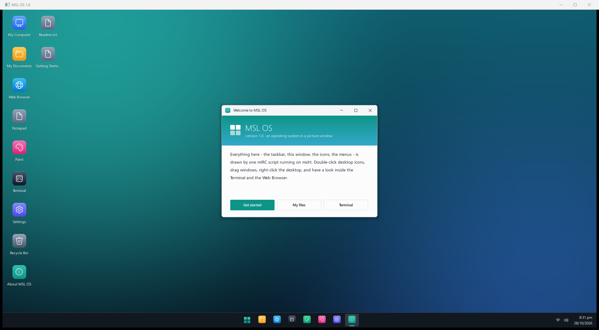

# MSL OS

A desktop operating system written in mIRC script (mSL), running on the
standalone [msl-runtime](https://github.com/ValwareIRC/msl-runtime).



Everything is drawn in one picture window by a small window manager:
draggable app windows, a taskbar, a Start menu, desktop icons and context
menus. Notepad, the file picker, Settings and Run are real mSL dialogs.

## Apps

- **File Explorer** – browse the virtual `C:\` disk
- **Notepad** and **Paint** – saved to the same virtual disk
- **Web Browser** – fetches real `http://` pages, plus a built-in `msl://home`
- **Terminal** – telnet / raw TCP / TLS client with ANSI colour

## Running

Get `mslrt` from [msl-runtime](https://github.com/ValwareIRC/msl-runtime), then:

```
mslrt msl-os.mrc
```

Or, from inside the runtime, type `/mo` to boot (or focus the desktop) and
`/mo.quit` to shut down and save.

### Terminal demo

`terminal-demo.mrc` is a tiny ANSI telnet server for trying the Terminal.
Run it in a second `mslrt`:

```
mslrt terminal-demo.mrc
```

then in the MSL OS Terminal: `telnet 127.0.0.1 2323`.

## Dev tools

- `tools/check-msl.ps1` – brace/paren balance and alias definition checks
- `tools/api.ps1` – send lines to a running `mslrt` control API
- `tools/termtest.ps1` – end-to-end Terminal test with a screenshot
- `tools/crop.ps1` – crop/zoom a screenshot region

## License

MIT, see [LICENSE](LICENSE).
